# Enterprise Multi-Tenant MPLS L3VPN: Carrier Infrastructure Lab


A service provider core built in Cisco Modeling Labs (CML) that carries two customers over one shared MPLS backbone. Each customer gets its own VRF, and **both customers deliberately use the same overlapping subnets** (`172.16.1.0/24` and `172.16.2.0/24`). The lab proves that the provider keeps them completely separate, and every result in this README is backed by a screenshot of real device output.

---

## Table of contents

1. [Overview](#overview)
2. [What is MPLS L3VPN?](#what-is-mpls-l3vpn)
3. [Topology and addressing](#topology-and-addressing)
4. [Design decisions](#design-decisions)
5. [Key configuration](#key-configuration)
6. [Verification and evidence](#verification-and-evidence)
7. [Results summary](#results-summary)

---

## Overview

The lab has three layers:

- **Underlay:** OSPF area 0 provides reachability between the loopbacks of all provider routers, and LDP distributes labels for those loopbacks.
- **Overlay:** MP-BGP with the VPNv4 address family carries customer routes between the provider edge (PE) routers, using route distinguishers (RD) and route targets (RT) to keep each customer's routes apart.
- **Customer edge:** four CE routers (two per customer) connect to the PEs with static routing, so the customers never run a routing protocol with the provider.

The provider core router (`P-Core`) runs only OSPF and LDP. It has no VRFs and no BGP, so it never sees a customer route.

## What is MPLS L3VPN?

MPLS Layer 3 VPN is a service provider technique for delivering private IP connectivity to many customers over one shared network. The PE routers keep a separate routing table (a VRF) per customer, exchange those customers' routes with each other using MP-BGP, and forward customer traffic across the core inside two MPLS labels: an outer transport label that gets the packet to the remote PE, and an inner VPN label that tells the remote PE which customer the packet belongs to. Carriers use it because it scales to thousands of customers, lets every customer keep its own addressing, and keeps the core simple.

Compared with building a mesh of IPsec or GRE tunnels between customer sites, MPLS L3VPN is configured on the provider side only, so adding a site means touching one PE rather than every other site. The trade-off is that the customer must trust the provider, because traffic is isolated by the provider's routing and labels rather than encrypted end to end.

## Topology and addressing

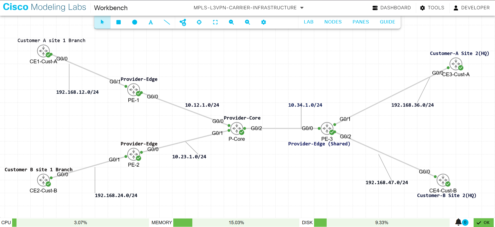
*CML topology: fourx provider routers in the core and edge, plus four customer sites.*

### Devices

| Hostname | CML label | Role | Loopback0 |
|---|---|---|---|
| P-Core | P-Core | Provider core (P router) | 1.1.1.1/32 |
| PE-1 | PE-1 | Provider edge, Customer A branch | 2.2.2.2/32 |
| PE-2 | PE-2 | Provider edge, Customer B branch | 3.3.3.3/32 |
| PE-3 | PE-3 | Provider edge, shared by both HQ sites | 4.4.4.4/32 |
| CE1-CustA-Branch | CE1-Cust-A | Customer A site 1 | 172.16.1.1/24 |
| CE2-CustB-Branch | CE2-Cust-B | Customer B site 1 | 172.16.1.1/24 |
| CE3-CustA-HQ | CE3-Cust-A | Customer A site 2 | 172.16.2.1/24 |
| CE4-CustB-HQ | CE4-Cust-B | Customer B site 2 | 172.16.2.1/24 |

### Links

| Link | Endpoint A | Endpoint B | Subnet |
|---|---|---|---|
| Core 1 | P-Core Gi0/0 (.2) | PE-1 Gi0/0 (.1) | 10.12.1.0/24 |
| Core 2 | P-Core Gi0/1 (.2) | PE-2 Gi0/0 (.1) | 10.23.1.0/24 |
| Core 3 | P-Core Gi0/2 (.2) | PE-3 Gi0/0 (.1) | 10.34.1.0/24 |
| Access 1 | PE-1 Gi0/1 (.1) | CE1-CustA-Branch Gi0/0 (.2) | 192.168.12.0/24 |
| Access 2 | PE-2 Gi0/1 (.1) | CE2-CustB-Branch Gi0/0 (.2) | 192.168.24.0/24 |
| Access 3 | PE-3 Gi0/1 (.1) | CE3-CustA-HQ Gi0/0 (.2) | 192.168.36.0/24 |
| Access 4 | PE-3 Gi0/2 (.1) | CE4-CustB-HQ Gi0/0 (.2) | 192.168.47.0/24 |

### VPN parameters

| Customer | VRF | RD | Route target (import and export) | Sites |
|---|---|---|---|---|
| Customer A | Customer_A | 100:1 | 100:1 | PE-1 (branch), PE-3 (HQ) |
| Customer B | Customer_B | 200:1 | 200:1 | PE-2 (branch), PE-3 (HQ) |

The provider AS number is **100**, and all BGP sessions are iBGP between loopbacks.

## Design decisions

**Overlapping customer address space.** Both customers use `172.16.1.0/24` at their branch and `172.16.2.0/24` at their HQ, and the two branch CEs even share the same loopback address `172.16.1.1`. This makes the isolation test meaningful: the same destination IP must reach a different router depending on which customer asks.

**One PE serves both customers. PE-3 holds both VRFs, one per customer-facing interface. This shows that separate VRFs, not separate hardware, keep customers apart. Each VRF has its own routing table, so a route learned for one customer never appears in the other customer's table. The route distinguisher (RD) makes identical prefixes unique inside the BGP table, and the route targets (RT) decide which VRF imports which routes.

**PE-1 and PE-2 peer only with PE-3.** Each customer has exactly two sites and both involve PE-3, so every route reaches the PE that needs it. A third site on another PE would require a full mesh or a route reflector.

**Static routing on the PE-CE links.** Each PE has a static route to the customer LAN inside its VRF, redistributed into BGP, and each CE has a default route to its PE. This keeps the focus on the VPN machinery rather than on PE-CE routing protocols.

**Loopback-based LDP and BGP.** LDP router IDs are pinned to Loopback0, and BGP sessions use `update-source Loopback0`, so the next hop of every VPN route is a /32 that carries a label.

## Key configuration

### Underlay (all provider routers, shown for P-Core)

```
router ospf 1
 router-id 1.1.1.1
 network 1.1.1.1 0.0.0.0 area 0
 network 10.12.1.0 0.0.0.255 area 0
 network 10.23.1.0 0.0.0.255 area 0
 network 10.34.1.0 0.0.0.255 area 0
!
mpls label protocol ldp
mpls ldp router-id Loopback0 force
!
interface GigabitEthernet0/0
 mpls ip
interface GigabitEthernet0/1
 mpls ip
interface GigabitEthernet0/2
 mpls ip
```

### Customer VRF and BGP on PE-1

```
ip vrf Customer_A
 rd 100:1
 route-target export 100:1
 route-target import 100:1
!
interface GigabitEthernet0/1
 ip vrf forwarding Customer_A
 ip address 192.168.12.1 255.255.255.0
!
ip route vrf Customer_A 172.16.1.0 255.255.255.0 192.168.12.2
!
router bgp 100
 bgp router-id 2.2.2.2
 no bgp default ipv4-unicast
 neighbor 4.4.4.4 remote-as 100
 neighbor 4.4.4.4 update-source Loopback0
 address-family vpnv4
  neighbor 4.4.4.4 activate
  neighbor 4.4.4.4 send-community extended
 exit-address-family
 address-family ipv4 vrf Customer_A
  redistribute connected
  redistribute static
 exit-address-family
```

### Both customers on PE-3

```
ip vrf Customer_A
 rd 100:1
 route-target export 100:1
 route-target import 100:1
ip vrf Customer_B
 rd 200:1
 route-target export 200:1
 route-target import 200:1
!
interface GigabitEthernet0/1
 ip vrf forwarding Customer_A
 ip address 192.168.36.1 255.255.255.0
interface GigabitEthernet0/2
 ip vrf forwarding Customer_B
 ip address 192.168.47.1 255.255.255.0
!
ip route vrf Customer_A 172.16.2.0 255.255.255.0 192.168.36.2
ip route vrf Customer_B 172.16.2.0 255.255.255.0 192.168.47.2
!
router bgp 100
 bgp router-id 4.4.4.4
 no bgp default ipv4-unicast
 neighbor 2.2.2.2 remote-as 100
 neighbor 2.2.2.2 update-source Loopback0
 neighbor 3.3.3.3 remote-as 100
 neighbor 3.3.3.3 update-source Loopback0
 address-family vpnv4
  neighbor 2.2.2.2 activate
  neighbor 2.2.2.2 send-community extended
  neighbor 3.3.3.3 activate
  neighbor 3.3.3.3 send-community extended
 exit-address-family
 address-family ipv4 vrf Customer_A
  redistribute connected
  redistribute static
 exit-address-family
 address-family ipv4 vrf Customer_B
  redistribute connected
  redistribute static
 exit-address-family
```

### Customer edge (CE1 shown)

```
interface Loopback0
 ip address 172.16.1.1 255.255.255.0
interface GigabitEthernet0/0
 ip address 192.168.12.2 255.255.255.0
ip route 0.0.0.0 0.0.0.0 192.168.12.1
```

### SSH between customer sites (identity proof)

Because the customer addresses overlap, a ping cannot show which router answered. The HQ routers (CE3 and CE4) run an SSH server, and the branch routers (CE1 and CE2) source their SSH client from Loopback0, so the login prompt reveals which device was reached.

```
! On CE3-CustA-HQ and CE4-CustB-HQ
ip domain name lab.local
username admin privilege 15 secret cisco
crypto key generate rsa modulus 2048
ip ssh version 2
line vty 0 4
 login local
 transport input ssh

! On CE1-CustA-Branch and CE2-CustB-Branch
ip domain name lab.local
crypto key generate rsa modulus 2048
ip ssh source-interface Loopback0
```

## Verification and evidence

### Phase 1: Underlay (OSPF and LDP)

#### 1. Interfaces are up with the planned addressing

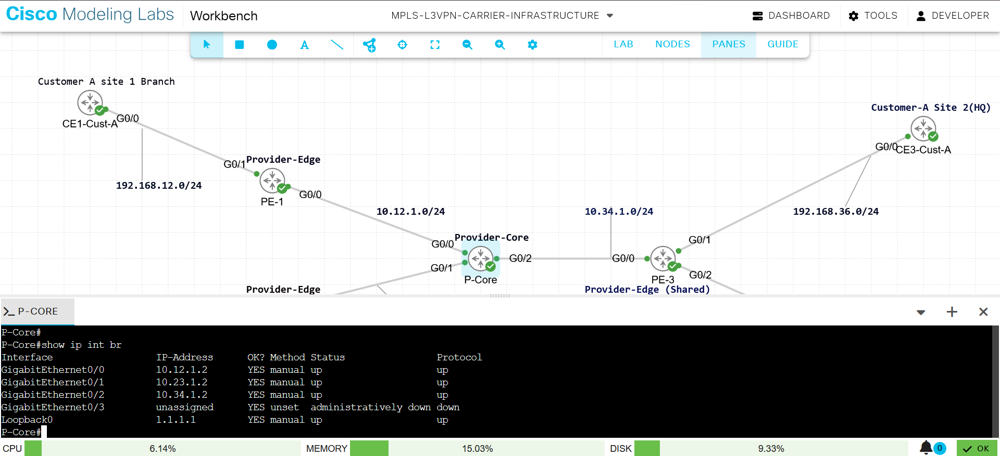
*P-Core: Gi0/0 to Gi0/2 are up/up on 10.12.1.2, 10.23.1.2 and 10.34.1.2, and Loopback0 is 1.1.1.1. Gi0/3 is unused and administratively down.*

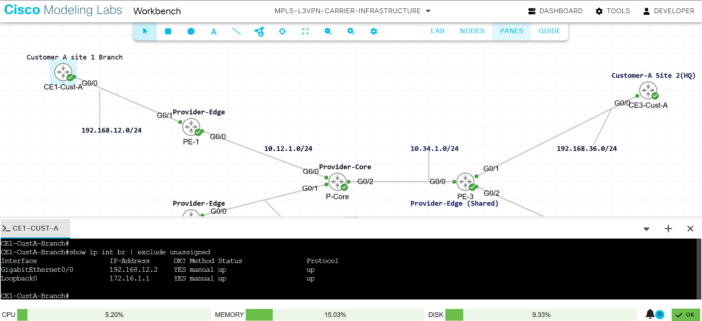
*CE1-CustA-Branch: Gi0/0 is 192.168.12.2 and Loopback0 is 172.16.1.1, both up/up.*

#### 2. OSPF adjacencies

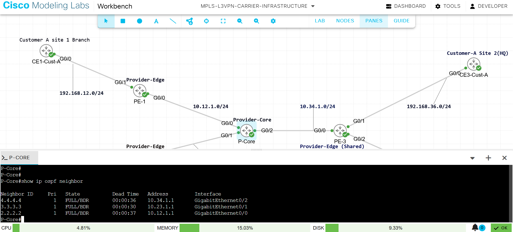
*P-Core has three OSPF neighbors in FULL state: 2.2.2.2 (PE-1), 3.3.3.3 (PE-2) and 4.4.4.4 (PE-3).*

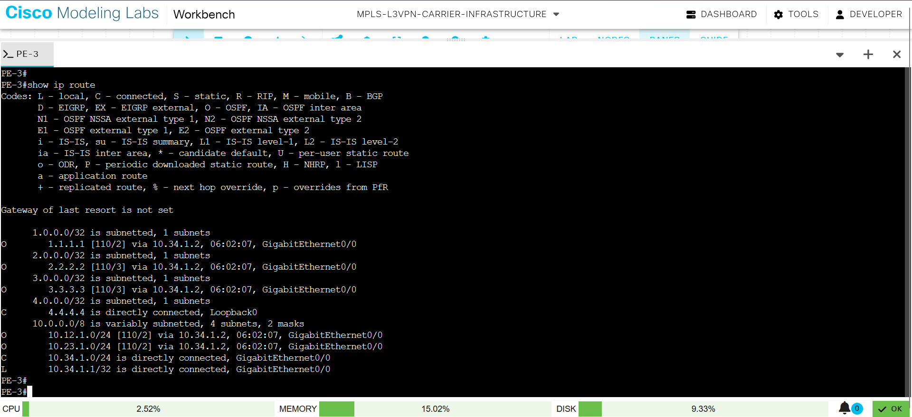
*PE-3 learns 1.1.1.1, 2.2.2.2 and 3.3.3.3 and the other core links through OSPF, all via P-Core at 10.34.1.2.*

#### 3. LDP sessions and MPLS interfaces

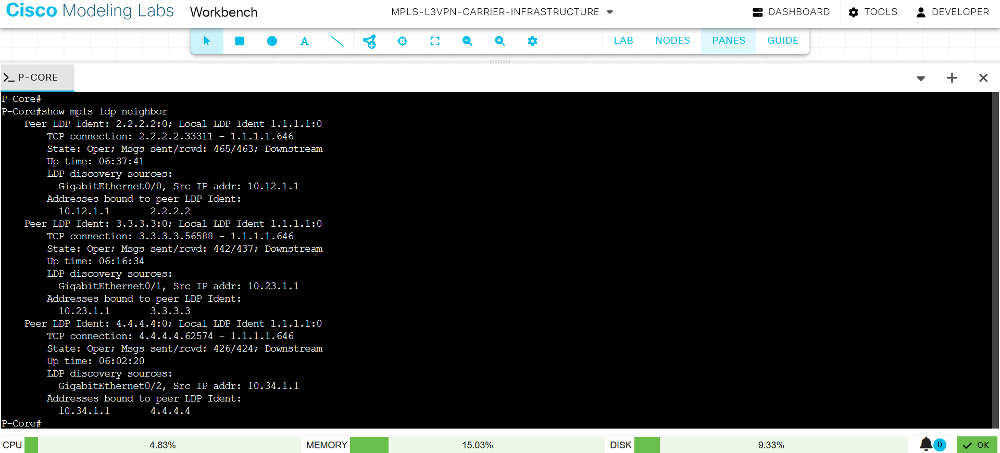
*P-Core has three operational LDP sessions, one per PE, with local LDP identifier 1.1.1.1:0.*

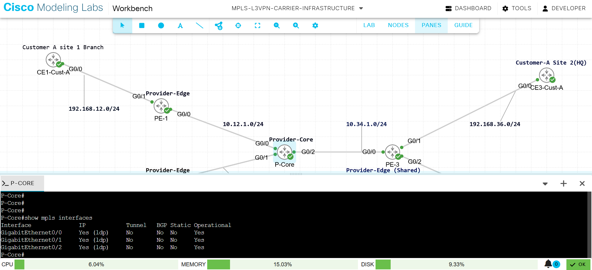
*MPLS forwarding is operational on all three core-facing interfaces.*

#### 4. Label distribution and label-switched forwarding

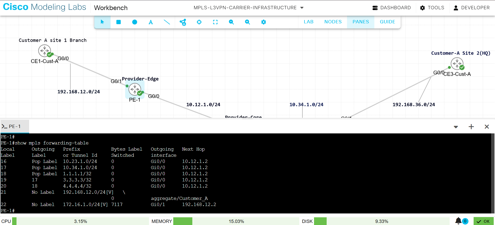
*PE-1 label table: it holds labels for the remote loopbacks 3.3.3.3 and 4.4.4.4 through P-Core, and entries tagged `[V]` that belong to the `Customer_A` VRF.*

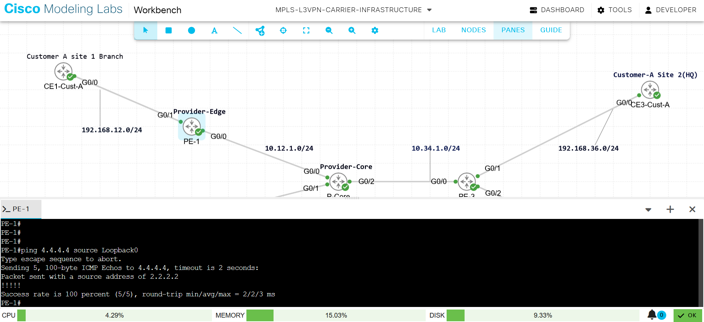
*PE-1 reaches PE-3's loopback from its own loopback with 100% success, which is the path BGP will use.*

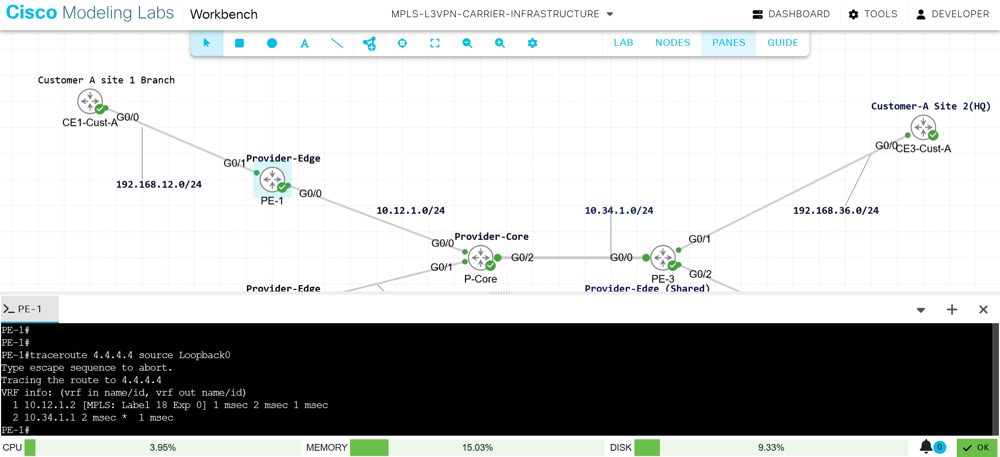
*The traceroute from PE-1 to 4.4.4.4 shows `[MPLS: Label 18 Exp 0]` on the P-Core hop, which confirms that traffic is label-switched through the core.*

### Phase 2: VPN services (VRF and MP-BGP)

#### 5. VRFs on the shared PE

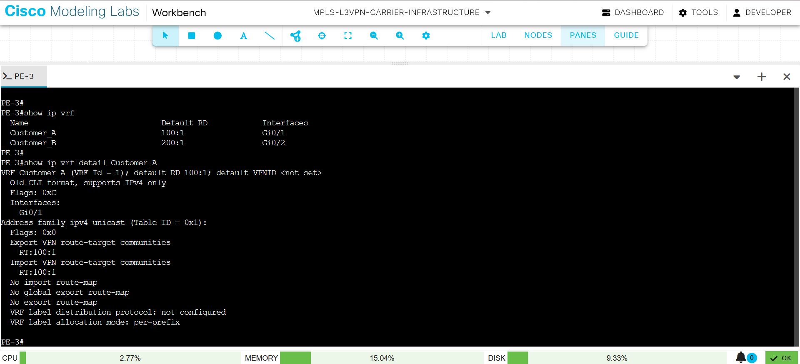
*PE-3 hosts both VRFs: `Customer_A` (RD 100:1) on Gi0/1 and `Customer_B` (RD 200:1) on Gi0/2. The detail output shows route target 100:1 for both import and export in `Customer_A`.*

#### 6. MP-BGP VPNv4 sessions

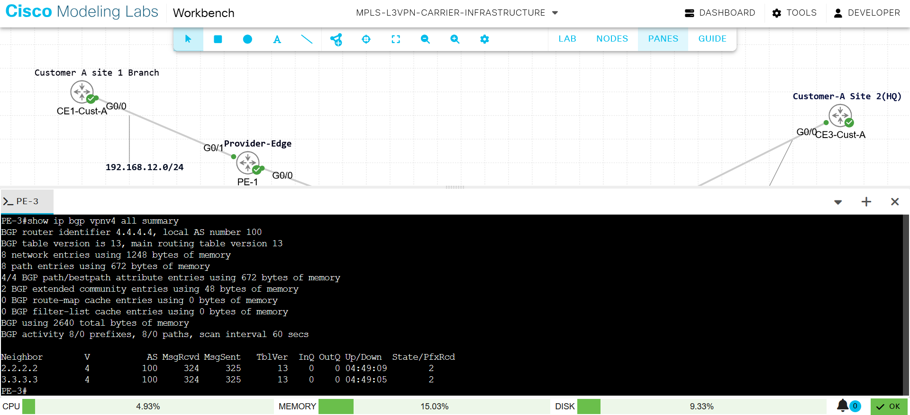
*PE-3 has established VPNv4 sessions with 2.2.2.2 and 3.3.3.3 in AS 100, each delivering two prefixes.*

#### 7. Overlapping prefixes live side by side

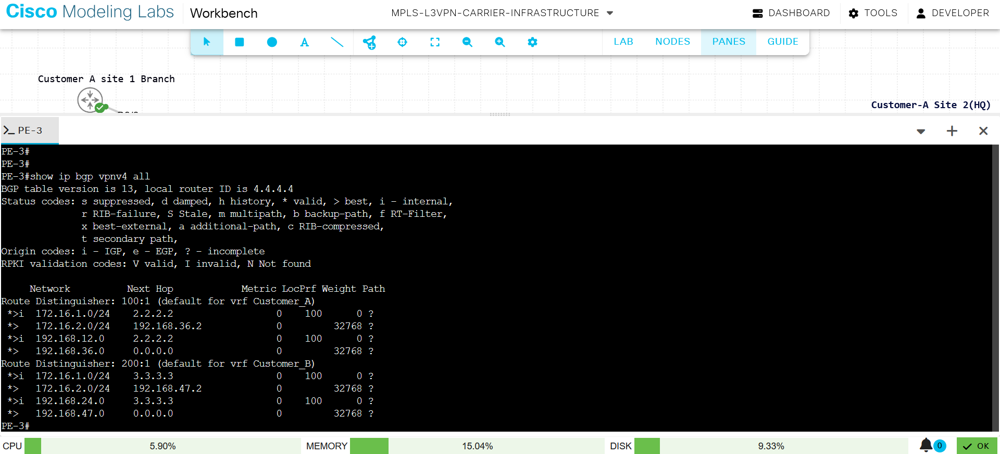
*The VPNv4 table holds `172.16.1.0/24` and `172.16.2.0/24` twice: once under RD 100:1 (`Customer_A`) and once under RD 200:1 (`Customer_B`). The route distinguisher is what makes identical prefixes unique in BGP.*

#### 8. Isolated routing tables

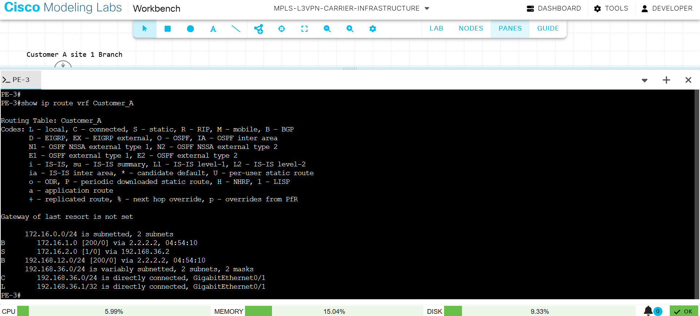
*`Customer_A` on PE-3: the branch LAN `172.16.1.0/24` arrives by BGP from 2.2.2.2, the HQ LAN `172.16.2.0/24` is a static route via CE3 (192.168.36.2), and only Customer A's link subnets appear.*

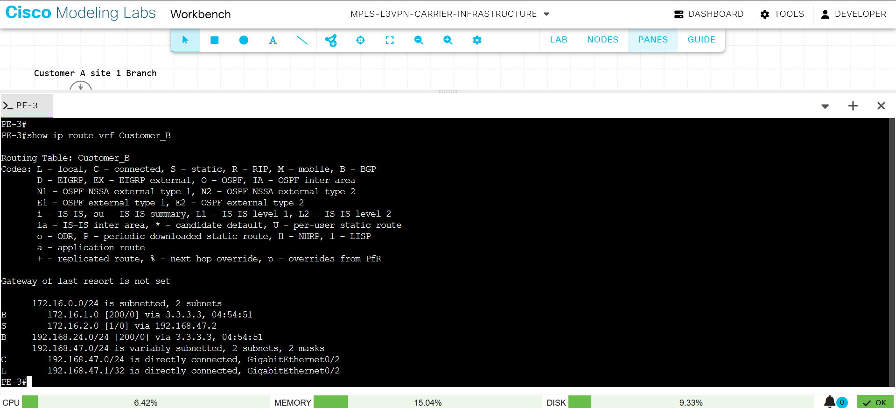
*`Customer_B` on PE-3: the branch LAN arrives by BGP from 3.3.3.3, the HQ LAN is a static route via CE4 (192.168.47.2), and nothing from Customer A is present.*

#### 9. PE-CE connectivity inside the VRFs

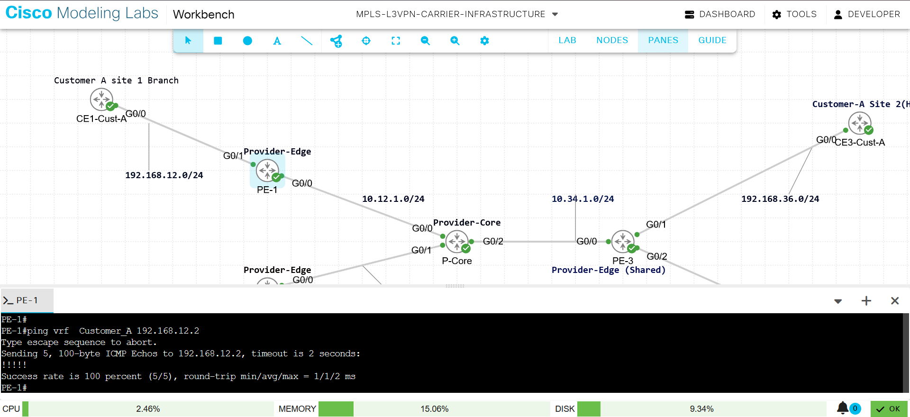
*PE-1 reaches CE1 (192.168.12.2) inside `Customer_A` with 100% success.*

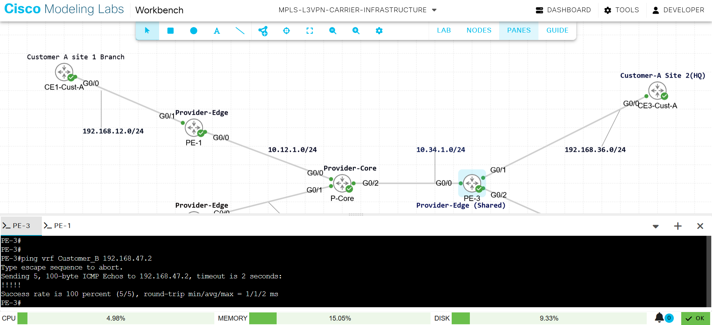
*PE-3 reaches CE4 (192.168.47.2) inside `Customer_B` with 100% success.*

#### 10. The two-label stack

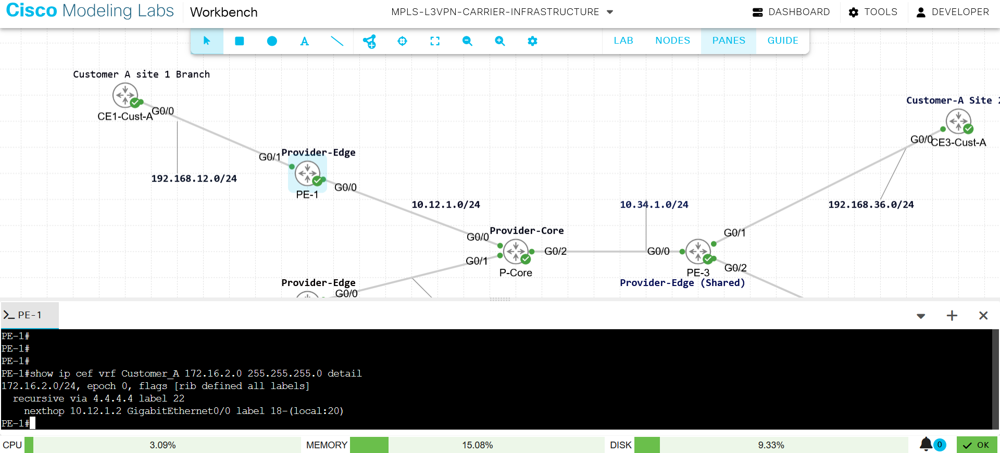
*PE-1's CEF entry for `172.16.2.0/24` in `Customer_A` recurses through 4.4.4.4 with VPN label 22 and sends the packet to 10.12.1.2 with transport label 18. This is the MPLS L3VPN data plane in one output.*

#### 11. Same destination IP, different customer

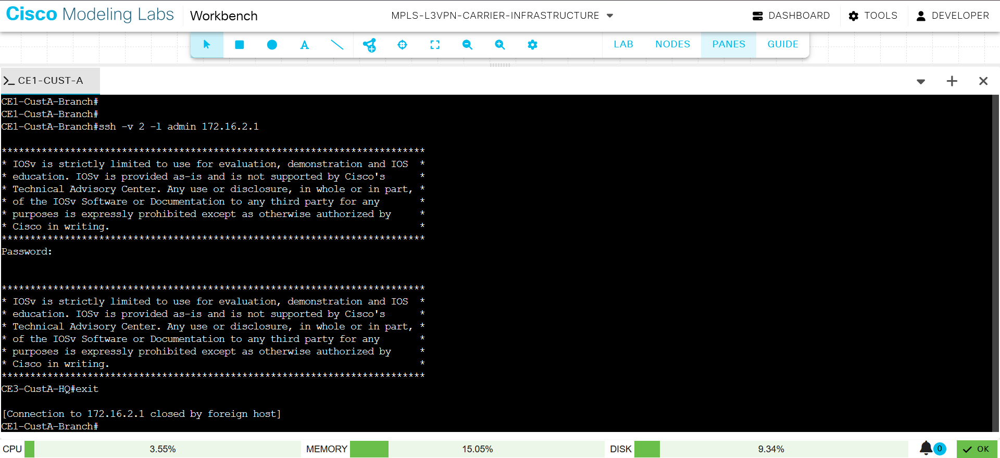
*CE1-CustA-Branch connects to `172.16.2.1` and lands on `CE3-CustA-HQ`.*

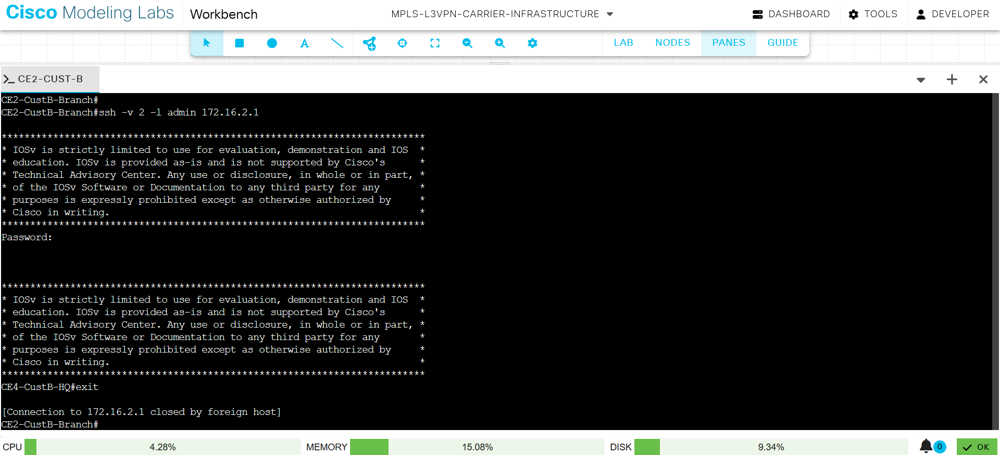
*CE2-CustB-Branch connects to the same address `172.16.2.1` and lands on `CE4-CustB-HQ`. Identical destination, different router, because each request is resolved inside its own customer's VRF.*

#### 12. Customer isolation

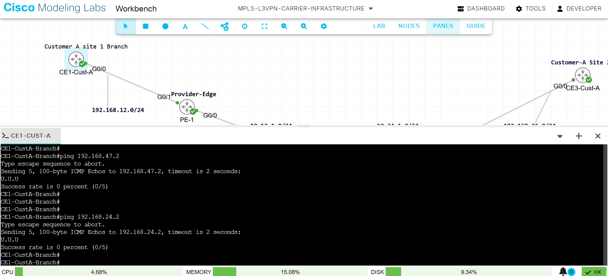
*From Customer A's CE1, pings to Customer B's addresses (`192.168.47.2` and `192.168.24.2`) return `U.U.U` and 0% success. The `U` means PE-1 answered "destination unreachable": the `Customer_A` VRF has no route to those networks. This is the correct outcome.*

#### 13. The core never sees customer routes

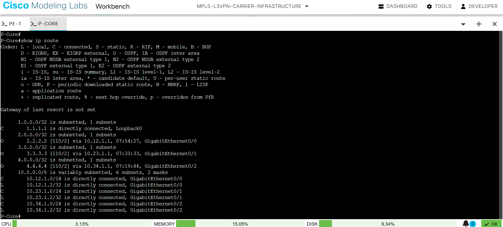
*P-Core's complete routing table contains only the four provider loopbacks and the three core subnets (connected and OSPF). There is no `172.16.x.x` or `192.168.x.x` route anywhere, so the core forwards customer traffic by label alone and has no knowledge of either customer's networks.*

## Results summary

| Test | Expected | Result | Evidence |
|---|---|---|---|
| OSPF adjacencies on P-Core | 3 neighbors FULL | Passed | [04](images/04-pcore-ospf-neighbors.png) |
| LDP sessions on P-Core | 3 operational sessions | Passed | [06](images/06-pcore-ldp-neighbors.png) |
| Label-switched path PE-1 to PE-3 | MPLS label on the core hop | Passed | [10](images/10-pe1-traceroute-mpls-labels.png) |
| VPNv4 sessions on PE-3 | 2 established, prefixes received | Passed | [12](images/12-pe3-bgp-vpnv4-summary.png) |
| Overlapping prefixes kept separate | Same prefix under two RDs | Passed | [13](images/13-pe3-bgp-vpnv4-table.png) |
| Per-customer routing tables | No cross-customer routes | Passed | [14](images/14-pe3-vrf-customer-a-routes.png), [15](images/15-pe3-vrf-customer-b-routes.png) |
| VPN label stack | Transport and VPN label | Passed | [18](images/18-pe1-cef-label-stack.png) |
| Same IP reaches different sites | CE3 for Customer A, CE4 for Customer B | Passed | [19](images/19-ce1-ssh-ce3-hq.png), [20](images/20-ce2-ssh-ce4-hq.png) |
| Cross-customer reachability | Blocked | Passed | [21](images/21-ce1-isolation-failed-pings.png) |
| Core is customer-blind | No customer routes on P-Core | Passed | [22](images/22-pcore-no-customer-routes.png) |

---

**Author:** [@mlungisi707](https://github.com/mlungisi707)
